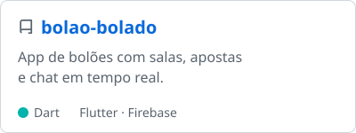
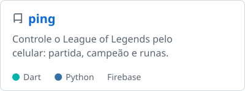
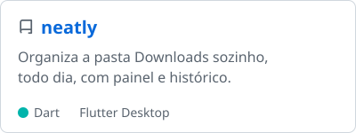

<picture><source media="(prefers-color-scheme: dark)" srcset="assets/banner-dark.svg"></picture>

## Sobre mim

Trabalho com backend de ERP para indústria em **InterSystems IRIS / ObjectScript**, lidando com regras de negócio complexas e integrações com sistemas de terceiros.

Fora do expediente, construo apps em **Flutter + Firebase** e automatizo tudo que se repete mais de duas vezes.

## Stack

**Trabalho**

    

**Projetos pessoais**

        

**Automação e ferramentas**

       

## Projetos

<a href="https://github.com/ArturoAndreatta/bolao-bolado"><picture><source media="(prefers-color-scheme: dark)" srcset="assets/bolao-bolado-dark.svg"></picture></a>
<a href="https://github.com/ArturoAndreatta/ping"><picture><source media="(prefers-color-scheme: dark)" srcset="assets/ping-dark.svg"></picture></a>
<a href="https://github.com/ArturoAndreatta/neatly"><picture><source media="(prefers-color-scheme: dark)" srcset="assets/neatly-dark.svg"></picture></a>

O Bolão Bolado está no ar: [bolaobolado-app.web.app](https://bolaobolado-app.web.app/)

## Contato

